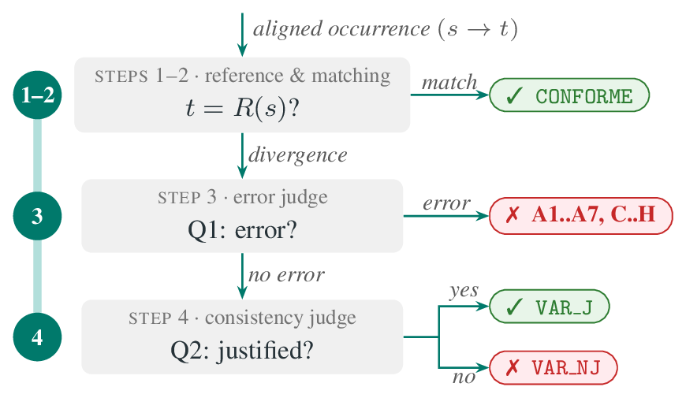

# TermJudge

[](https://github.com/nicolasdahan/termjudge/actions/workflows/tests.yml) [](LICENSE) 

TermJudge is a document-level terminology metric for machine translation: for every occurrence of a term in a translated document, it decides, with an LLM judge, whether the translation is correct and whether it is consistent with the rest of the document, and it aggregates these verdicts into a score.

The metric is described in *TermJudge: A Document-Level Metric Judging, Not Counting, Terminology in Machine Translation Evaluation* (Nicolas Dahan, François Yvon, Rachel Bawden, [WMT 2026](https://aclanthology.org/2026.wmt-main.6/)). This repository contains the code of the metric and BioMQM-Terms, the terminology evaluation resource built for the paper from the bio-MQM corpus (`data/biomqm/`).

## Installation

```
git clone https://github.com/nicolasdahan/termjudge.git
cd termjudge
pip install .
```

Python 3.10 or later; the only dependencies are `openai` and `tqdm`. The optional extra `[lemmas]` adds spaCy, used to lemmatise the French side of the inputs with the model of the paper:

```
pip install ".[lemmas]"
python -m spacy download fr_core_news_lg
```

Two commands are installed: `termjudge-annotate` (the judges, one verdict per occurrence) and `termjudge-score` (penalties and aggregation, no LLM call).

## Quick start

The toy example in `examples/toy/` is a one-document corpus translated by two systems, with a five-entry glossary. It runs without any API key:

```
examples/toy/run_toy.sh
```

This annotates the two systems in dry-run mode (no LLM call: divergences default to `VAR_NJ`, hapax are skipped) and scores them. The outputs land under `examples/toy/output/<SYSTEM>/runs/dry-run/`: `annotations/doc1.json` (one verdict per occurrence), `chains/doc1.md` (a readable view, one table per concept), `scores_per_document.csv` and `scores_aggregated.csv`.

With a judge, the same example takes about twenty LLM calls:

```
export OPENAI_API_KEY=...
examples/toy/run_toy.sh full
```

The script is a plain `termjudge-annotate` call followed by `termjudge-score`; `termjudge-annotate --help` lists every option.

### From Python

The two commands can be called with the same arguments from Python:

```python
from termjudge.metric import annotate, score

annotate.main([
    "--input-dir", "examples/toy/alignments", "--glossary", "examples/toy/glossary.csv",
    "--source-docs-dir", "examples/toy/source", "--target-docs-dir", "examples/toy/targets",
    "--output-dir", "output", "--dry-run",
])
score.main(["--annotations-dir", "output"])
```

## Choosing the judge

TermJudge talks to the judge through the chat completions protocol of the `openai` Python client, so any model served through that protocol can be the judge.

- OpenAI API (the paper's setting): set `OPENAI_API_KEY` and pass `--model gpt-4.1-mini`. The client negotiates the request parameters of the model family on its first call (recent OpenAI models reject `max_tokens` or a fixed temperature).
- Any OpenAI-compatible endpoint: pass `--base-url`. For example, start a vLLM server on a GPU machine and point TermJudge at it:

  ```
  vllm serve Qwen/Qwen3-0.6B --port 8765 --default-chat-template-kwargs '{"enable_thinking": false}'
  termjudge-annotate ... --base-url http://<host>:8765/v1 --model Qwen/Qwen3-0.6B
  ```

  With `--base-url`, requests always use the classic style (`temperature` and `max_tokens`), and the API key is `--api-key`, else `VLLM_API_KEY`, else the dummy key `EMPTY` that a local server accepts. The toy example runs this way with `BASE_URL=http://<host>:8765/v1 MODEL=Qwen/Qwen3-0.6B examples/toy/run_toy.sh full`, and `data/biomqm/run_termjudge.sh` reads the same two variables (see below).

The paper's numbers were obtained with `gpt-4.1-mini`; another judge gives other verdicts.

## Input format

TermJudge needs, for each document, the source text and each system's output (one segment per line), and the aligned term occurrences: for each occurrence of a term, the source form, the segment index and the target span produced by the system. A glossary (SKOS CSV) is optional. Occurrences are given as one JSON file per (system, document); the three required fields are `source_term`, `source_segment_ids` and `target_term`, and the optional fields (head term, glossary identifier, lemmas, variation category, segment texts) have documented fallbacks. The format is specified in [docs/input_format.md](docs/input_format.md), with the glossary format and the conventions for the document texts.

Producing the occurrences (term detection, variation labelling and source-to-target alignment) is not part of TermJudge. In the paper it is done by the Concordancer pipeline; `scripts/from_concordancer.py` converts its output, and `docs/concordancer_prompts/` documents the two LLM prompts it uses for alignment and variation labelling. Any other tool producing the same information can be used.

## Output format

`termjudge-annotate` writes, under `<output-dir>/<SYSTEM>/runs/<run_tag>/`:

- `annotations/<DOC>.json`: one record per occurrence, with the verdict and everything that led to it: `source_term`, `target_term`, `target_canonical`, the reference `reference` with its provenance `reference_source` (`glossary`, `frequency`, `first`, `llm`, `generate`, or `none` when no reference could be established), `match_level` (`exact`, `graphic`, `none`), `is_hapax`, `is_first_mention`, the judges' answers (`q1_code` and `q1_justification`, `hapax_code` and `hapax_justification`, `q2_reason` and `q2_justification`), and `verdict`.
- `chains/<DOC>.md`: the same information as a Markdown table per concept, with the full source and target texts and a legend.
- `generated_references/<DOC>.jsonl`: the audit trail of the references validated or generated by the LLM.
- `run_meta.json` and `prompts_used/`: the configuration and the exact prompt templates of the run.

`termjudge-score` reads the annotations and writes `scores_per_document.csv` (`doc_id`, `n_occurrences`, `total_penalty`, `score`, and one `n_<verdict>` column per verdict) and `scores_aggregated.csv` (one row per system: `n_documents`, `total_occurrences`, `total_penalty`, `mean_score` and the verdict counts) next to them. The score of a document is the mean penalty over its occurrences, lower is better; the system score is the mean of its document scores. The penalties can be overridden with `--penalties '{"VAR_NJ": 1}'`, and `--exclude-hapax` scores only the chains with at least two occurrences.

### Verdicts

| Verdict | Meaning | Penalty |
|---|---|---|
| `CONFORME` | target matches the reference, or judged error-free | 0 |
| `VAR_J` | variation, consistent with the document | 0 |
| `VAR_NJ` | variation, inconsistent (neutralisation, synonym inconsistency, gratuitous divergence) | 0.5 |
| `A1` | attested term of a neighbouring concept | 1 |
| `A2` | paraphrase instead of the term | 1 |
| `A3` | invented literal calque | 3 |
| `A4` | left untranslated | 4 |
| `A5` | do-not-translate item translated | 4 |
| `A6` | wrong internal constituent | 4 |
| `A7` | general-language word instead of the term | 3 |
| `C` | mis-parsed term structure | 4 |
| `D` | wrong semantic relations between constituents | 3 |
| `E` | failed transposition, syntactic calque | 1 |
| `F` | grammar or phraseology around the term | 1 |
| `G` | content altered (addition, omission, hallucination) | 1 |
| `H` | defective target-language expression or register | 1 |
| `SKIPPED_HAPAX` | hapax not judged (`--hapax-mode skip` or dry run) | 0 (left out by `--exclude-hapax`) |

`A1` to `A7` follow level A of the error typology of Carcamo et al.; `C` to `H` group its other families, each scored at its most lenient sub-code. The code lists are kept in `termjudge/metric/typology.py` (error codes) and `termjudge/metric/q2.py` (consistency labels: `introduction`, `explicitation`, `avoid_repetition`, `document_usage`, `register`, `facet`, `synonym_merge` give `VAR_J`; `neutralisation`, `synonym_inconsistency`, `gratuitous_divergence` give `VAR_NJ`).

## The decision tree



For each source form of a concept in a document (a *chain* of occurrences; a chain of size one is a *hapax*), the reference R(s) is the glossary translation when the form is the head term, and otherwise the system's most frequent rendering in the document, checked by the error judge and regenerated by the LLM when it is wrong (`--reference-mode validated`). A target whose lemma matches the reference is `CONFORME` without any LLM call. The other targets, and every hapax, go to the error judge (Q1): an error code is the final verdict; an error-free divergence goes to the consistency judge (Q2), which answers `VAR_J` or `VAR_NJ`, and an error-free hapax is `CONFORME`. Q1 is asked once per distinct (source form, target) pair of a document and its verdict is propagated; Q2 is asked for each occurrence. The verdicts map to penalties, averaged per document.

Both judges receive the current segment, the preceding segment pairs (`--context-window`), the concept's glossary entry when there is one, and the concept's earlier renderings in the document grouped by source form. The prompts are in `src/termjudge/metric/prompts/`; the error judge's prompt is also used for hapax and for validating references.

## Worked example

Document `doc17` of BioMQM-Terms, human reference translation, judged by `gpt-4.1-mini` in the configuration of the paper. The concept *emergency contraception* occurs nine times, as the head term and as the acronym *EC*; the glossary gives *Contraception post-coïtale*.

| Seg | Source form | Target | 1. Reference R(s) | 2. Match | 3. Q1 | 4. Q2 | Verdict |
|---|---|---|---|---|---|---|---|
| 0 | Emergency contraception | Contraception d'urgence | Contraception post-coïtale (glossary) | none | no_error | introduction | `VAR_J` |
| 1 | emergency contraception | contraception d'urgence | Contraception post-coïtale (glossary) | none | no_error | document_usage | `VAR_J` |
| 1 | EC | CU | CU (document, validated) | exact | | | `CONFORME` |
| 2 | EC | contraception d'urgence | CU (document, validated) | none | no_error | neutralisation | `VAR_NJ` |
| 3, 3, 4, 5, 6 | EC | CU | CU (document, validated) | exact | | | `CONFORME` |

Step 1: the head term takes the glossary label as reference; the acronym, a variant with no glossary label, takes the document's most frequent rendering, *CU*, after the error judge has confirmed it is a valid term. Step 2: the six *EC* / *CU* pairs match the reference and are `CONFORME` without any LLM call. Step 3: the three divergences go to the error judge, which finds no error in any of them (*contraception d'urgence* is an attested term for the concept). Step 4: the consistency judge accepts the first mention (`introduction`) and its repetition (`document_usage`), but flags the *EC* occurrence rendered as *contraception d'urgence*: it reproduces the rendering reserved for the head term and erases the author's distinction between the two forms (`neutralisation`). Step 5: the penalties (0, 0, 0.5 and six zeros) enter the mean over the 27 occurrences of the document.

The record of the flagged occurrence in `annotations/doc17.json`:

```json
{
  "system": "reference", "doc_id": "doc17", "term_id": 201,
  "concept_key": "emergency contraception",
  "source_term": "EC", "target_term": "contraception d'urgence",
  "target_canonical": "contraception d'urgence", "variation_category": "VG",
  "reference": "CU", "reference_source": "frequency", "reference_confidence": "high",
  "match_level": "none", "is_hapax": false, "is_first_mention": false,
  "verdict": "VAR_NJ",
  "q1_code": "NO",
  "q1_justification": "The expected French form for the acronym EC is CU, but the target uses the full term 'contraception d'urgence' which is an established equivalent; thus the target is a valid attested form.",
  "q1_propagated": false, "q1_source_seg": "",
  "hapax_code": "", "hapax_justification": "",
  "q2_reason": "neutralisation",
  "q2_justification": "The document has established 'CU' as the dominant rendering for the variant 'EC', but this occurrence uses 'contraception d'urgence', the established rendering for the head term, thus reproducing the rendering of another source form.",
  "source_segment_ids": [2],
  "concept_preflabel_en": "emergency contraception", "concept_preflabel_fr": "Contraception post-coïtale"
}
```

and its line in `scores_per_document.csv` (zero columns omitted):

```
doc_id,n_occurrences,total_penalty,score,n_A1,n_A2,n_C,n_CONFORME,n_VAR_J,n_VAR_NJ
doc17,27,10.5,0.3889,1,1,2,19,3,1
```

## The configuration of the paper

All the experiments of the paper use the same judge, `gpt-4.1-mini` at temperature 0, and the prompts shipped in this package. The document-level experiments (BioMQM-Terms, and the NLP corpora with `--domain NLP`) use:

```
termjudge-annotate ... \
  --reference-mode validated --q1-mode llm --q2-mode llm --hapax-mode evaluate \
  --judge-path auto --llm-shortcuts non_hapax --propagate-q1 on --propagate-pick last \
  --context-window 5 --domain biomedical --model gpt-4.1-mini --max-tokens 256
```

The occurrence-level validation on the STEP corpus, and the exhaustive-path ablation, send every occurrence to the judges, matches and hapax included: `--judge-path q1q2 --llm-shortcuts none --reference-mode "glossary>frequency>first"`.
The paper's verdicts were obtained with occurrence files produced by the Concordancer, where `head_term`, `term_id`, `source_lemma`, `target_lemma` and `variation_category` are filled in. TermJudge runs without these fields, with the fallbacks documented in [docs/input_format.md](docs/input_format.md), but its verdicts are then not strictly those of the paper's configuration.

## Cost and cache

Every judge call is cached in `<output-dir>/cache/<model>/cache.jsonl` (or `--cache-dir`), keyed by the model, the prompt family, the system message, the user message and the temperature. Rerunning a configuration costs nothing; changing a prompt, the context window or the domain changes the prompts, hence the keys. On BioMQM-Terms (13,200 occurrences, ten systems), the paper's configuration makes about 12,000 judgements, about six US dollars with `gpt-4.1-mini` at list price; a run prints a token report, and `--price-in` and `--price-out` (US dollars per million tokens) turn it into a cost estimate. `--workers N` processes documents concurrently, and `--save-prompts auto` dumps every call as a readable file under `<output-dir>/_prompt_dumps/<run_tag>/`.

## Running TermJudge on BioMQM-Terms

`data/biomqm/` contains BioMQM-Terms: the English-French glossary of 710 biomedical concepts built for the paper (`glossary/`), the 50 source documents of the bio-MQM corpus (`source/`), the outputs of its eight MT systems and two human references (`targets/`), and the 1,320 aligned term occurrences of each system in the input format of TermJudge (`alignments/`), 13,200 term-translation pairs in all. [data/biomqm/DATASHEET.md](data/biomqm/DATASHEET.md) documents its provenance, construction, statistics and limitations.

The exact command of the paper on this dataset is `data/biomqm/run_termjudge.sh` (with `OPENAI_API_KEY` set, or `BASE_URL` and `MODEL` for another judge):

```
data/biomqm/run_termjudge.sh
```

It writes the annotations under `output/biomqm/<SYSTEM>/runs/paper/` and the scores next to them. Extra arguments are passed on to `termjudge-annotate`; a quick trial on one system and one document with an open judge is

```
BASE_URL=http://<host>:8765/v1 MODEL=Qwen/Qwen3-0.6B data/biomqm/run_termjudge.sh --systems LISN_run1 --max-docs 1
```

The paper's tables come from a meta-evaluation against the human MQM scores that is not part of this repository, so this command reproduces the paper's verdicts and document scores, not its tables.

## License and attribution

The code is released under the MIT license (see `LICENSE`). BioMQM-Terms is derived from the bio-MQM corpus of Zouhar et al. (2024), distributed under the Apache License 2.0 (`data/biomqm/LICENSE-bio-mqm`, `data/biomqm/NOTICE-bio-mqm`), and its glossary uses labels from the MeSH thesaurus of the U.S. National Library of Medicine; see the datasheet for the terms that apply to each part.

## Citation

```
@inproceedings{dahan-etal-2026-termjudge,
    title = "{T}erm{J}udge: A Document-Level Metric Judging, Not Counting, Terminology in Machine Translation Evaluation",
    author = "Dahan, Nicolas  and
      Yvon, Fran{\c{c}}ois  and
      Bawden, Rachel",
    editor = "Haddow, Barry  and
      Kocmi, Tom  and
      Koehn, Philipp  and
      Monz, Christof",
    booktitle = "Proceedings of the Eleventh Conference on Machine Translation",
    month = oct,
    year = "2026",
    address = "Budapest, Hungary",
    publisher = "Association for Computational Linguistics",
    url = "https://aclanthology.org/2026.wmt-main.6/",
    pages = "82--115",
    ISBN = "979-8-89176-474-3"
}
```
